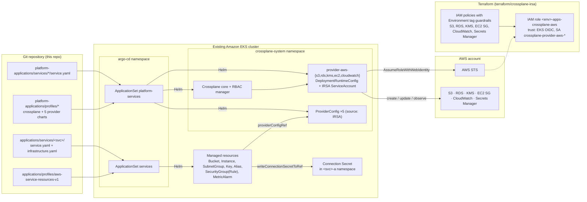

# crossplane-aws-platform

Kubernetes-native AWS infrastructure provisioning with [Crossplane](https://www.crossplane.io/), the
Upbound AWS family providers, IRSA and Argo CD GitOps.

Application teams describe the AWS resources a service needs (S3 bucket, PostgreSQL on RDS, KMS key,
database security group, CloudWatch alarms) in a small YAML file next to the service definition. Argo CD
renders that file through a Helm chart into Crossplane managed resources, and Crossplane continuously
reconciles them against AWS. Permissions are bounded by an IAM role, created by Terraform, whose policies
only allow changes to resources tagged with the matching `Environment`.

This repository was extracted from a working setup on Amazon EKS. Organisation-specific identifiers were
replaced with placeholders; the architecture, templates and IAM guardrails are kept as they were. See
[Provenance and changes](#provenance-and-changes).

## Contents

- [Problem statement](#problem-statement)
- [What is implemented](#what-is-implemented)
- [Architecture](#architecture)
- [Repository layout](#repository-layout)
- [Prerequisites and integration with an existing EKS cluster](#prerequisites-and-integration-with-an-existing-eks-cluster)
- [Installation](#installation)
- [IAM and IRSA](#iam-and-irsa)
- [Provider configuration](#provider-configuration)
- [XRDs, Compositions and the resource abstraction](#xrds-compositions-and-the-resource-abstraction)
- [Argo CD integration](#argo-cd-integration)
- [Usage examples](#usage-examples)
- [Testing and validation](#testing-and-validation)
- [Troubleshooting](#troubleshooting)
- [Known limitations](#known-limitations)
- [Security notes](#security-notes)
- [Provenance and changes](#provenance-and-changes)

## Problem statement

Without a control plane, per-service AWS infrastructure is usually handled in one of two ways:

- **A Terraform stack per service.** Every database or bucket needs a separate state file, a pipeline and
  someone who knows Terraform. Drift is only detected the next time `plan` runs.
- **Tickets to a platform team.** Delivery is slow, and naming, tagging and encryption settings become
  inconsistent between teams.

Crossplane turns AWS resources into Kubernetes objects, so you can apply the same practices you already use
for workloads:

| Concern | How it is handled here |
|---|---|
| Declarative desired state | Crossplane managed resources (`Bucket`, `Instance`, `Key`, ...) |
| Continuous drift correction | Crossplane providers reconcile every resource, not only on deploy |
| Self-service with guardrails | A Helm chart with safe defaults (encryption, private access, deletion protection, backups) |
| GitOps delivery and review | Argo CD ApplicationSets driven by `service.yaml` / `infrastructure.yaml` |
| Least privilege, no static keys | IRSA role whose IAM policies require an `Environment` tag match |
| Consistent tagging and cost allocation | Tags rendered centrally by the chart templates |

Terraform is still used for the things that must exist before Crossplane can run: the IRSA role, its
policies and the EKS/OIDC prerequisites.

## What is implemented

Only components that exist in the original implementation are included.

| AWS service | Crossplane kinds (`*.aws.upbound.io`) | Provider package |
|---|---|---|
| S3 | `Bucket`, `BucketACL`, `BucketPublicAccessBlock` | `xpkg.upbound.io/upbound/provider-aws-s3:v2.1.0` |
| RDS | `Instance` (PostgreSQL by default), `SubnetGroup` | `xpkg.upbound.io/upbound/provider-aws-rds:v2.1.0` |
| KMS | `Key`, `Alias` (used for RDS storage and the master user secret) | `xpkg.upbound.io/upbound/provider-aws-kms:v2.1.0` |
| EC2 | `SecurityGroup`, `SecurityGroupRule` (database access only; no EC2 instances) | `xpkg.upbound.io/upbound/provider-aws-ec2:v2.1.0` |
| CloudWatch | `MetricAlarm` ×5 for the RDS instance (CPU, memory, disk space, queue depth, burst balance) | `xpkg.upbound.io/upbound/provider-aws-cloudwatch:v2.1.0` |

Core components:

| Component | Version |
|---|---|
| Crossplane Helm chart (`charts.crossplane.io/stable`) | `2.1.3` |
| `ProviderConfig` | `aws.upbound.io/v1beta1`, `credentials.source: IRSA` |
| `DeploymentRuntimeConfig` | `pkg.crossplane.io/v1beta1` |
| Terraform AWS provider (lock file) | `6.13.0` |

Not implemented: CompositeResourceDefinitions (XRDs), Compositions, Composition Functions, EC2 instances,
and CloudWatch alarms for anything other than RDS. See
[XRDs, Compositions and the resource abstraction](#xrds-compositions-and-the-resource-abstraction).

## Architecture



Request flow for one service:

1. A developer adds or changes `applications/services/<svc>/infrastructure.yaml` in a pull request.
2. The `services` ApplicationSet generates or updates the Argo CD Application `<svc>`. It renders
   `aws-service-resources-v1` with `service.yaml` and `infrastructure.yaml` as Helm values.
3. Argo CD applies the managed resources in sync-wave order: KMS `Key` (-2), `Alias` (-1), the security
   group and other unordered resources (0), `SubnetGroup` (1), RDS `Instance` (2).
4. Each provider assumes the IRSA role and calls the AWS API. IAM allows the call only if the `Environment`
   tag matches the environment of the role.
5. Crossplane resolves cross-resource references (`kmsKeyIdRef`, `dbSubnetGroupNameRef`,
   `vpcSecurityGroupIdRefs`, `securityGroupIdRef`, `bucketRef`), writes connection details to a Secret in
   the service namespace, and keeps reconciling.

## Repository layout

```text
.
├── argocd/                                   # Argo CD AppProjects and ApplicationSets
│   ├── appproject-platform-services.yaml
│   ├── applicationset-platform-services.yaml
│   ├── appproject-services.yaml
│   └── applicationset-services.yaml
├── platform-applications/                    # Platform layer, synced by "platform-services"
│   ├── profiles/                             # Helm charts ("profiles")
│   │   ├── crossplane-adopted/               # Wraps the upstream crossplane chart 2.1.3
│   │   └── crossplane-provider-aws-{s3,rds,kms,ec2,cloudwatch}-adopted/
│   │       └── templates/                    # Provider, DeploymentRuntimeConfig, ProviderConfig
│   └── services/                             # One directory = one Argo CD Application
│       ├── service.yaml                      # Values shared by all platform services
│       ├── crossplane/service.yaml
│       └── crossplane-provider-aws-*/service.yaml
├── applications/                             # Service layer, synced by "services"
│   ├── profiles/aws-service-resources-v1/    # Renders AWS managed resources from values
│   └── services/
│       ├── service.yaml
│       └── example-service/{service.yaml,infrastructure.yaml}
├── examples/                                 # Stand-alone values files for the chart above
├── terraform/crossplane-irsa/                # IRSA role + guard-railed IAM policies
├── scripts/
│   ├── validate.sh                           # helm lint/template + kubeconform + wiring checks
│   └── check-sensitive.sh                    # Blocks real AWS account / resource IDs
└── .github/
    ├── workflows/validate.yml                # CI: yamllint, helm, kubeconform, terraform, checkov, actionlint, gitleaks
    └── dependabot.yml
```

A *profile* is a Helm chart. A *service* is a directory with a `service.yaml` that names the profile and
provides its values. The ApplicationSets turn each service directory into one Argo CD Application. The
suffix `-adopted` marks charts that wrap or configure upstream software rather than in-house workloads.

## Prerequisites and integration with an existing EKS cluster

This project does not create a cluster or a VPC. It expects:

| Requirement | Notes |
|---|---|
| Amazon EKS cluster | The Terraform default name is `<environment>-apps`. Set `kubernetes_cluster_name` to use any existing cluster. |
| IAM OIDC provider for the cluster | Required for IRSA. Check with `aws iam list-open-id-connect-providers`. Create with `eksctl utils associate-iam-oidc-provider --cluster <name> --approve`. |
| Argo CD (namespace `argo-cd`) | Required for the GitOps flow. Helm alone also works (see [Option B](#3b-option-b-helm-without-argo-cd)). |
| VPC with private subnets | At least two subnets in different AZs for the RDS subnet group, plus the VPC CIDR for the security group rule. |
| Terraform `>= 1.5` with an S3 backend | The backend block is a partial configuration (`backend "s3" {}`). |
| A deployer IAM role | Terraform assumes `target_account_deploy_role` and needs permission to manage IAM roles and policies. |
| Optional: Istio | Providers and Crossplane carry `traffic.sidecar.istio.io/excludeInboundPorts: "9443"` so that webhook traffic bypasses the sidecar. Set `istio-injection: disabled` in `service.yaml` if you do not use Istio. |
| Optional: node labels | The service values pin pods to nodes labelled `usageType=platform-arm64`. Remove or change `nodeSelector` to match your node groups. |

Tools used in this README: `aws`, `terraform`, `kubectl`, `helm` (v3), and optionally the
[`crossplane` CLI](https://docs.crossplane.io/latest/cli/) for `crossplane beta trace`.

## Installation

### 1. Create the IRSA role (Terraform)

```bash
cd terraform/crossplane-irsa
cp inputs.tfvars.example staging.tfvars        # edit: account, role, VPC, cluster name

terraform init \
  -backend-config="bucket=<state-bucket>" \
  -backend-config="key=crossplane-aws-platform/staging/terraform.tfstate" \
  -backend-config="region=us-east-1"

terraform plan -var-file=staging.tfvars -out=staging.tfplan
# Review the plan, then apply it through your normal change process.

terraform output -raw crossplane_provider_aws_role_arn
```

`*.tfvars` and `*.tfplan` files are git-ignored. Only `inputs.tfvars.example` is committed.

| Variable | Required | Default | Description |
|---|---|---|---|
| `environment` | yes | – | Environment name, for example `staging` or `prod`. Used in names, tags and IAM conditions. |
| `target_account_deploy_role` | yes | – | Role ARN that Terraform assumes in the target account. |
| `namespace` | yes | – | Namespace of the provider ServiceAccounts (`crossplane-system`). |
| `application` | yes | – | Kept for compatibility. Not referenced by resources. |
| `vpc_id` | yes | – | Kept for compatibility. Not referenced by resources. |
| `aws_region` | no | `us-east-1` | Region of the cluster and the managed resources. |
| `kubernetes_cluster_name` | no | `<environment>-apps` | Existing EKS cluster used to look up the OIDC provider. |
| `rds_managed_secret_name_prefix` | no | `rds!` | Name prefix of RDS-managed master user secrets. |
| `kms_key_arn`, `crossplane_provider_role_name` | no | – | Kept for compatibility. Not referenced by resources. |

Outputs: `crossplane_provider_aws_role_arn`, `crossplane_kms_policy_arn`, `crossplane_rds_kms_policy_arn`.

### 2. Point the platform values at your environment

Set the role ARN from step 1 in each provider service:

```bash
ROLE_ARN="$(terraform -chdir=terraform/crossplane-irsa output -raw crossplane_provider_aws_role_arn)"
for f in platform-applications/services/crossplane-provider-aws-*/service.yaml; do
  sed -i "s#arn:aws:iam::111111111111:role/staging-apps-crossplane-aws#${ROLE_ARN}#" "$f"
done
```

Also review `customLabels`, `nodeSelector` and `istio-injection` in `platform-applications/services/*`.

### 3a. Option A: GitOps with Argo CD

Replace `https://github.com/your-org/crossplane-aws-platform.git` in `argocd/*.yaml` with your fork. If the
repository is private, register it as an Argo CD repository first. Then apply the manifests:

```bash
kubectl apply -n argo-cd -f argocd/appproject-platform-services.yaml -f argocd/appproject-services.yaml
kubectl apply -n argo-cd -f argocd/applicationset-platform-services.yaml
# Wait until Crossplane and the providers are healthy (see step 4), then enable the service layer:
kubectl apply -n argo-cd -f argocd/applicationset-services.yaml
```

### 3b. Option B: Helm without Argo CD

```bash
helm repo add crossplane-stable https://charts.crossplane.io/stable
helm dependency build platform-applications/profiles/crossplane-adopted

helm upgrade --install crossplane platform-applications/profiles/crossplane-adopted \
  -n crossplane-system --create-namespace \
  -f platform-applications/services/service.yaml \
  -f platform-applications/services/crossplane/service.yaml --wait

# Helm rejects a release that contains an unknown kind, and the ProviderConfig CRD is owned by the
# family provider. Install the family provider first (the AWS providers would pull it in as a dependency).
kubectl apply -f - <<'EOF'
apiVersion: pkg.crossplane.io/v1
kind: Provider
metadata:
  name: upbound-provider-family-aws
spec:
  package: xpkg.upbound.io/upbound/provider-family-aws:v2.1.0
EOF
kubectl wait provider.pkg.crossplane.io/upbound-provider-family-aws --for=condition=Healthy --timeout=10m
kubectl wait crd/providerconfigs.aws.upbound.io --for=condition=Established --timeout=5m

for p in s3 rds kms ec2 cloudwatch; do
  helm upgrade --install crossplane-provider-aws-$p platform-applications/profiles/crossplane-provider-aws-$p-adopted \
    -n crossplane-system \
    -f platform-applications/services/service.yaml \
    -f platform-applications/services/crossplane-provider-aws-$p/service.yaml
done
```

The Helm release name must be `crossplane-provider-aws-<family>`. It becomes the Provider,
ProviderConfig and ServiceAccount name, and the IRSA trust policy and the service chart both depend on it.

### 4. Verify

```bash
kubectl get pods -n crossplane-system
kubectl get providers.pkg.crossplane.io
# NAME                                 INSTALLED   HEALTHY   PACKAGE
# crossplane-provider-aws-s3           True        True      xpkg.upbound.io/upbound/provider-aws-s3:v2.1.0
# upbound-provider-family-aws          True        True      xpkg.upbound.io/upbound/provider-family-aws:v2.1.0
kubectl get providerconfigs.aws.upbound.io
kubectl get sa -n crossplane-system crossplane-provider-aws-s3 \
  -o jsonpath='{.metadata.annotations.eks\.amazonaws\.com/role-arn}{"\n"}'
```

`upbound-provider-family-aws` is installed automatically as a package dependency. It owns the shared
`ProviderConfig` CRD and does not call AWS APIs, so it does not need the IRSA role.

## IAM and IRSA

One IAM role, `<environment>-apps-crossplane-aws`, is shared by all five providers.

**Trust policy (`iam.tf`)**: `sts:AssumeRoleWithWebIdentity` from the cluster OIDC provider, with these
conditions:

```text
<oidc>:aud = sts.amazonaws.com
<oidc>:sub LIKE system:serviceaccount:<namespace>:crossplane-provider-aws-*
```

The `DeploymentRuntimeConfig` of every provider creates a ServiceAccount named after the Helm release
(`crossplane-provider-aws-<family>`), annotated with `eks.amazonaws.com/role-arn`. The EKS pod identity
webhook injects the web identity token. The `ProviderConfig` with `credentials.source: IRSA` makes the
provider use that token.

**Permission policies.** Most write actions are conditioned on the `Environment` tag, so a staging role
cannot modify production resources even in a shared account.

| File | Scope |
|---|---|
| `iam.tf` | `AmazonS3FullAccess` (AWS managed policy) |
| `iam-rds.tf` | Create DB instances, subnet groups and snapshots with `aws:RequestTag/Environment`. Modify, delete, start and stop only with `rds:ResourceTag/Environment`. |
| `rds_subnet_group.tf` | Additional subnet-group policy with the same tag guardrail. |
| `iam-rds-kms.tf` | `kms:CreateGrant` only via `rds.<region>.amazonaws.com`, for AWS resources, on env-tagged keys. |
| `iam-kms.tf` | Create keys. Tag only with `Environment` + `Application`. Manage policy, rotation and deletion only on env-tagged keys. Aliases only named `alias/<env>-*`. |
| `iam-kms-alias-policy.tf` | Alias management limited to `alias/<env>-*`. |
| `iam-ec2-sg.tf` | Create security groups. Tag with `Environment=<env>` and an allow-listed set of tag keys. Delete only env-tagged groups. |
| `iam-cloudwatch.tf` | Put and delete metric alarms in the account/region. Tag only with `Environment=<env>`. |
| `iam-secretsmanager-rds.tf` | Create and manage the RDS-managed master user secret (`secret:rds!*`). |

As a consequence, every managed resource must carry `Environment: <env>` with the same value as the
Terraform `environment`. The chart sets it from `metadata.environment` (default `staging`).

## Provider configuration

Each provider chart renders three objects (example for S3, from `helm template`):

```yaml
apiVersion: pkg.crossplane.io/v1
kind: Provider
metadata:
  name: crossplane-provider-aws-s3
spec:
  package: xpkg.upbound.io/upbound/provider-aws-s3:v2.1.0
  runtimeConfigRef:
    name: crossplane-provider-aws-s3
---
apiVersion: pkg.crossplane.io/v1beta1
kind: DeploymentRuntimeConfig
metadata:
  name: crossplane-provider-aws-s3
spec:
  deploymentTemplate:
    spec:
      replicas: 1
      template:
        metadata:
          annotations:
            traffic.sidecar.istio.io/excludeInboundPorts: "9443"
        spec:
          serviceAccountName: crossplane-provider-aws-s3
          containers:
            - name: package-runtime
              resources: {requests: {cpu: 250m, memory: 512Mi}, limits: {cpu: 250m, memory: 512Mi}}
  serviceAccountTemplate:
    metadata:
      name: crossplane-provider-aws-s3
      annotations:
        eks.amazonaws.com/role-arn: arn:aws:iam::111111111111:role/staging-apps-crossplane-aws
---
apiVersion: aws.upbound.io/v1beta1
kind: ProviderConfig
metadata:
  name: crossplane-provider-aws-s3
  annotations:
    argocd.argoproj.io/sync-wave: "1"
    argocd.argoproj.io/sync-options: SkipDryRunOnMissingResource=true
spec:
  credentials:
    source: IRSA
```

Chart values (`platform-applications/profiles/crossplane-provider-aws-*-adopted/values.yaml`):

| Key | Default | Description |
|---|---|---|
| `package` | `xpkg.upbound.io/upbound/provider-aws-<family>:v2.1.0` | Provider package. Keep all families on the same version. |
| `customLabels` | `{}` | Labels added to all objects. |
| `serviceAccount.annotations` | `{}` | Set `eks.amazonaws.com/role-arn`. |
| `nodeSelector` | `{}` | Node selector for the provider pod. |
| `resources` | 250m / 512Mi | Requests and limits of the `package-runtime` container. |

There is one ProviderConfig per family, named like the provider. The service chart selects them through
`s3.providerConfigRef` and `rds.providerConfigRefs.{rds,ec2,kms,cloudwatch}`.

To upgrade providers, bump `package` in all five `values.yaml` files together. `scripts/validate.sh`
fails if the versions differ, and it validates against the CRDs of the new version.

## Architecture: Helm-Based Resource Abstraction.

**The original implementation contains no XRDs and no Compositions, and this repository does not add any.**
The abstraction that application teams use is the Helm chart
`applications/profiles/aws-service-resources-v1`:

| Crossplane concept | Equivalent in this repository |
|---|---|
| XRD (API schema) | `values.yaml` of `aws-service-resources-v1` (`s3.*`, `rds.*`, `metadata.*`) |
| Composition (resource template) | `templates/aws-*.yaml` (Go templates rendering managed resources) |
| Claim / XR instance | `applications/services/<svc>/infrastructure.yaml` |
| Composition revision | Chart directory version suffix (`-v1`) |
| Function-based defaults and validation | Helm `default` / `required` / `regexMatch` in the templates |

Trade-offs of this design:

- No Composition Functions to run or debug, and the rendered output is visible in Argo CD and in
  `helm template` before anything reaches the cluster.
- Developers already know the "profile + values" model from their workload charts.
- Validation happens at render time, not at admission time. A malformed `infrastructure.yaml` fails the
  Argo CD sync instead of being rejected by the API server.
- There is no composite resource status that aggregates readiness. Use Argo CD health or
  `kubectl get managed` per resource.
- The managed resources are cluster-scoped (`*.aws.upbound.io`), so namespace isolation relies on Argo CD
  projects and naming rather than on namespaced claims.

Migrating to Crossplane v2 XRDs would mean defining the `values.yaml` schema as an XRD (namespaced XRs are
the default in v2) and moving the templates into a Composition pipeline, for example with
`function-go-templating`, whose syntax is close to the current templates. That migration is not part of
this repository.

## Argo CD integration

The manifests in `argocd/` define two AppProjects and two ApplicationSets. The specs match the original
setup, where they were managed by Terraform `helm_release` resources wrapping the `bedag/raw` chart.

| ApplicationSet | Generator | Source path | Values files | Destination |
|---|---|---|---|---|
| `platform-services` | `platform-applications/services/*/service.yaml` | `platform-applications/profiles/{{ profile }}` | `services/service.yaml`, `services/{{ name }}/service.yaml` | `{{ namespace }}` (`crossplane-system`) |
| `services` | `applications/services/*/service.yaml` | `applications/profiles/{{ profile }}` | `…/service.yaml`, `…/{{ name }}/service.yaml`, `…/{{ name }}/infrastructure.yaml` (optional) | `{{ name }}-a` |

Behaviour that matters for Crossplane:

- **CRD ordering.** A `ProviderConfig` can only be applied after the provider package has installed its
  CRDs. The ProviderConfig therefore has `sync-wave: "1"` and `SkipDryRunOnMissingResource=true`, so the
  first sync does not fail on the missing kind and a later retry creates it.
- **Resource ordering in a service.** Sync waves `-2` (Key), `-1` (Alias), `1` (SubnetGroup) and `2`
  (Instance) apply dependencies first. Crossplane references resolve anything that is still pending.
- **Deletion safety.** `preserveResourcesOnDeletion: true` on both ApplicationSets keeps the generated
  Applications' resources when an Application is removed from the generator. RDS instances and KMS keys
  also have `deletionPolicy: Orphan` and `managementPolicies` without `Delete`, so the AWS resource stays
  even if the Kubernetes object is deleted.
- **Server-side apply.** `ServerSideApply=true` is enabled for platform services.
- **KMS alias drift.** The Alias carries an inline `argocd.argoproj.io/ignore-differences` annotation for
  fields the provider fills in (`external-name`, `targetKeyId`).
- The `ignoreDifferences` entries for Istio `VirtualService` and Argo Rollouts `Rollout` come from the
  original workload setup. They have no effect on Crossplane resources.

The ApplicationSets use the default (non-Go) template syntax `{{ name }}`. Keep `goTemplate` disabled or
convert the expressions to `{{ .name }}`.

## Usage examples

All examples render with the chart `applications/profiles/aws-service-resources-v1`. Account IDs, subnet,
VPC and key IDs are placeholders.

### Render locally (no cluster needed)

```bash
helm template orders applications/profiles/aws-service-resources-v1 -n orders-a \
  -f examples/rds-postgres-kms-cloudwatch.yaml | less
```

### S3: private bucket — [`examples/s3-private-bucket.yaml`](examples/s3-private-bucket.yaml)

```yaml
s3:
  enabled: true
  bucketName: staging-orders-artifacts
  region: us-east-1
  forceDestroy: false
  acl:
    enabled: false
  publicAccessBlock:
    enabled: true
  providerConfigRef: crossplane-provider-aws-s3
```

Result: `Bucket` + `BucketPublicAccessBlock` (all four blocks enabled). Set `acl.enabled: true` to add a
`BucketACL`. New buckets have ACLs disabled by default (*Bucket owner enforced* object ownership), and S3
can reject ACL requests with `AccessControlListNotSupported`. This chart does not manage ownership controls,
so the example service keeps `acl.enabled: false`.

### RDS + KMS + EC2 + CloudWatch — [`examples/rds-postgres-kms-cloudwatch.yaml`](examples/rds-postgres-kms-cloudwatch.yaml)

```yaml
metadata:
  application: orders
  environment: staging
rds:
  enabled: true
  kms:
    create: true
    keyName: orders-db-kms
    alias: staging-orders-db            # IAM: must start with "<environment>-"
    keyAdministrators:
      - arn:aws:iam::111111111111:role/staging-apps-crossplane-aws
  subnetGroup:
    subnetIds: [subnet-0123456789abcdef0, subnet-0123456789abcdef1]
  securityGroup:
    vpcId: vpc-0123456789abcdef0
    vpcCidr: 10.0.0.0/16
  instance:
    identifier: staging-orders-db       # prefix with the environment (see Known limitations)
  master:
    managePasswordWithAWS: true
  cloudwatch:
    enabled: true
    snsTopicArn: arn:aws:sns:us-east-1:111111111111:staging-alerts
```

Rendered resources:

| Kind | Name | Purpose |
|---|---|---|
| `kms.Key` | `orders-db-kms` | CMK with rotation, key policy from `keyAdministrators` / `keyEncryptDecrypt` |
| `kms.Alias` | `staging-orders-db` | `alias/staging-orders-db` → key |
| `ec2.SecurityGroup` | `staging-orders-db-access` | DB security group in the VPC |
| `ec2.SecurityGroupRule` ×2 | `…-ingress`, `…-egress-all` | TCP 5432 from the VPC CIDR; all egress |
| `rds.SubnetGroup` | `orders-db-subnet` | From `subnetGroup.name` (default `<namespace>-<release>-db-subnet`) |
| `rds.Instance` | `staging-orders-db` | PostgreSQL 17.5, gp3, encrypted, Multi-AZ, deletion protection, 14-day backups, Performance Insights, master password in Secrets Manager encrypted with the CMK |
| `cloudwatch.MetricAlarm` ×5 | `staging-orders-db-*` | `BurstBalance`, `FreeStorageSpace`, `CPUUtilization`, `DiskQueueDepth`, `FreeableMemory` |

Connection details go to the Secret `<release>-db` (or `rds.connectionSecret.name`) in the release
namespace. With `managePasswordWithAWS: true` the password itself stays in AWS Secrets Manager. Retrieve it
there or sync it with External Secrets.

### RDS with an existing KMS key and a Kubernetes-managed password — [`examples/rds-postgres-existing-kms.yaml`](examples/rds-postgres-existing-kms.yaml)

```yaml
rds:
  enabled: true
  kms:
    create: false
    keyArn: arn:aws:kms:us-east-1:111111111111:key/00000000-0000-0000-0000-000000000000
  master:
    managePasswordWithAWS: false
    passwordSecretName: payments-db-master   # must exist in the release namespace
    passwordSecretKey: password
  cloudwatch:
    enabled: false
```

### Through GitOps

Copy `applications/services/example-service/` to `applications/services/<svc>/`, set `name`, `metadata`
and `infrastructure.yaml`, and open a pull request. After merge, the `services` ApplicationSet creates the
Application `<svc>` targeting namespace `<svc>-a`.

### Observe the result

```bash
kubectl get managed                                          # all managed resources
kubectl get instance.rds.aws.upbound.io staging-orders-db
kubectl get key.kms.aws.upbound.io,alias.kms.aws.upbound.io
kubectl get metricalarm.cloudwatch.aws.upbound.io
crossplane beta trace instance.rds.aws.upbound.io staging-orders-db   # requires the crossplane CLI
```

## Testing and validation

All checks are offline. They never contact a cluster or AWS and never run `terraform apply`.

```bash
./scripts/validate.sh          # helm lint + template + kubeconform + provider wiring
./scripts/check-sensitive.sh   # no real AWS account / VPC / subnet / SG / KMS IDs
yamllint --strict .
terraform -chdir=terraform/crossplane-irsa fmt -check -recursive
terraform -chdir=terraform/crossplane-irsa init -backend=false && terraform -chdir=terraform/crossplane-irsa validate
checkov -d terraform/crossplane-irsa --framework terraform --baseline terraform/crossplane-irsa/.checkov.baseline
actionlint
gitleaks dir --redact .
```

`scripts/validate.sh`:

1. Reads the Crossplane chart version and the provider package version from the charts, and checks that
   all five providers pin the same version.
2. Runs `helm lint --strict` on every chart.
3. Renders every platform service, every application service (also with S3 and RDS forced on), every
   file in `examples/`, and each provider chart with empty values.
4. Downloads the CRDs for exactly those versions (Crossplane `pkg.crossplane.io`, provider-aws
   `*.aws.upbound.io`) and converts them to JSON Schema.
5. Runs `kubeconform -strict` (unknown fields are errors) on the rendered output and `argocd/*.yaml`.
6. Checks that every managed resource references an existing `ProviderConfig`, and that every provider
   ServiceAccount matches the IRSA trust pattern and carries a role annotation.

The GitHub Actions workflow `.github/workflows/validate.yml` runs the same checks on every pull request
and on pushes to `main`, using read-only `contents` permission and no cloud credentials:

| Job | Tools |
|---|---|
| `yamllint` | yamllint (Helm templates excluded; they are checked after rendering) |
| `kubernetes-manifests` | helm, kubeconform, `scripts/validate.sh` |
| `terraform` | `terraform fmt`, `init -backend=false`, `validate`, checkov with baseline |
| `actionlint` | actionlint |
| `secrets-scan` | gitleaks (full history), `scripts/check-sensitive.sh` |

The checkov baseline accepts three findings: `CKV_AWS_355` on the CloudWatch and Secrets Manager policies
(`cloudwatch:DescribeAlarms` and `secretsmanager:CreateSecret`/`GetRandomPassword` do not support
resource-level permissions), and `CKV_AWS_290` on the Secrets Manager policy. Any new finding fails the job.

For an end-to-end test, use a non-production account and a disposable cluster (for example kind with
static credentials, or a sandbox EKS). Enable a single bucket first, then the RDS stack.

## Troubleshooting

| Symptom | Likely cause | What to check |
|---|---|---|
| Provider `HEALTHY=False` | Package pull failed, or the pod cannot be scheduled | `kubectl describe provider.pkg.crossplane.io <name>`, `kubectl get pods -n crossplane-system`. If pods are `Pending`, check `nodeSelector`. |
| Argo CD: `the server could not find the requested resource (ProviderConfig)` | Provider CRDs not installed yet | Wait for the provider to become healthy, then sync again. `SkipDryRunOnMissingResource` handles the first sync. |
| Managed resource `SYNCED=False` with `WebIdentityErr` / `InvalidIdentityToken` | IRSA wiring | ServiceAccount annotation (`kubectl get sa -n crossplane-system`), OIDC provider exists in IAM, SA name matches `crossplane-provider-aws-*`, namespace matches the Terraform `namespace`. |
| `AccessDenied` on create, tag, delete or alias calls | IAM tag guardrail | `metadata.environment` must equal the Terraform `environment`. KMS alias must start with `<env>-`. Only allow-listed tag keys may be added to security groups. |
| `cannot resolve references` on Instance or Alias | Referenced object missing or named differently | The Key's `metadata.name` is normalised (lower case, `_`→`-`, 63 chars) but the references use the raw `keyName`. Use a lower-case, hyphenated `keyName`. |
| RDS Instance never becomes ready, references `masterUserSecretKmsKeyIdRef` | `managePasswordWithAWS: true` with `kms.create: false` | This combination references a Key that is not rendered. Use `kms.create: true`, or a Kubernetes password secret. |
| CloudWatch alarms stay in `INSUFFICIENT_DATA` | Alarm dimension does not match the DB identifier | Use an `instance.identifier` that already starts with `<env>-` (see Known limitations). |
| Webhook timeouts with Istio | Sidecar intercepts port 9443 | Keep the `excludeInboundPorts: "9443"` annotation, or disable injection for `crossplane-system`. |
| Deleting the Application leaves AWS resources | Intended | `preserveResourcesOnDeletion`, `deletionPolicy: Orphan`, no `Delete` management policy. Remove resources deliberately (see below). |

Useful commands:

```bash
kubectl get providers.pkg.crossplane.io,providerrevisions.pkg.crossplane.io
kubectl logs -n crossplane-system deploy/crossplane-provider-aws-rds --tail=200
kubectl get managed -o wide
kubectl describe instance.rds.aws.upbound.io <name>      # see Events and status.conditions
kubectl get events -n crossplane-system --sort-by=.lastTimestamp
```

Deliberately deleting a protected database: set `deletionProtection` to false in AWS (see
[Known limitations](#known-limitations) for why it cannot be set through values). Then either delete it in
AWS and remove the Kubernetes object, or temporarily add `Delete` to `managementPolicies` and set
`deletionPolicy: Delete`.

## Known limitations

These behaviours come from the original templates and Terraform. They were kept to preserve the
working logic and are documented here instead of being changed.

1. **Boolean RDS options cannot be turned off from values.** The template uses
   `default true .Values.rds.instance.<flag>`, and Helm treats `false` as empty. As a result, `multiAZ`,
   `deletionProtection`, `copyTagsToSnapshot` and `performanceInsightsEnabled` are always `true`.
2. **CloudWatch alarm dimension versus RDS identifier.** The Instance identifier is prefixed with
   `<env>-` if it is not already, but the alarm dimension uses the raw `rds.instance.identifier`. Always
   use an identifier that already starts with `<env>-`.
3. **KMS key name normalisation.** `Key.metadata.name` is normalised, but `kmsKeyIdRef`,
   `targetKeyIdRef` and `masterUserSecretKmsKeyIdRef` use the raw `keyName`.
4. **`managePasswordWithAWS` requires `kms.create: true`**, because `masterUserSecretKmsKeyIdRef` always
   points at the chart-managed Key.
5. **`master.generatePassword: true` does not generate a password.** It only changes the default secret
   name to `<release>-db-password`, and that Secret must already exist.
6. **`securityGroup.create` and `instance.iamAuthEnabled` are not used** by the templates. The security
   group is always created when `rds.enabled` is true.
7. **`s3.bucketName` has no default**, and S3 resources carry no tags. The S3 permission is
   `AmazonS3FullAccess`, so there is no tag guardrail for S3.
8. **Single environment in the source.** AWS providers and AWS templates existed only in staging. The
   Terraform module has a prod input file there, but it lacked the required `vpc_id`.
9. **No `required_providers` block.** The AWS provider version is pinned only by `.terraform.lock.hcl`
   (6.13.0).
10. **Overlapping subnet-group permissions** in `iam-rds.tf` and `rds_subnet_group.tf`.
11. **Provider-version alignment.** The templates use `v1beta1` APIs. All of them are served by
    provider-aws v2.1.0 and none is deprecated, but RDS `Instance` stores as `v1beta2` and newer API
    versions (`Instance v1beta3`, `Bucket v1beta2`, `MetricAlarm v1beta2`) exist.

## Security notes

- No static AWS credentials. Providers use IRSA, and Terraform assumes a deployer role.
- Default resource settings: encrypted RDS storage, `publiclyAccessible: false`, deletion protection,
  backups for 14 days, RDS CA `rds-ca-rsa2048-g1`, S3 public access block on, KMS key rotation on.
- The KMS key policy is generated only from `keyAdministrators` and `keyEncryptDecrypt`. Add the Crossplane
  role to `keyAdministrators`, otherwise the provider can lose access to a key it created. Also consider
  adding the account root to avoid an unmanageable key.
- The security group rule allows all egress (`0.0.0.0/0`) and ingress from the whole VPC CIDR. Narrow
  `vpcCidr` if needed.
- The AppProjects allow every cluster-scoped kind and every source repository (`"*"`). Restrict
  `sourceRepos` and `clusterResourceWhitelist` for multi-tenant clusters.
- `s3.forceDestroy` defaults to `true` in the chart. Set it to `false` for buckets with important data.

## Provenance and changes

Source of each part of this repository:

| Path here | Origin in the original setup |
|---|---|
| `terraform/crossplane-irsa/` | Terraform stack for the Crossplane IRSA role and policies |
| `platform-applications/profiles/crossplane-*` | Platform GitOps repository, staging profiles |
| `platform-applications/services/*` | Platform GitOps repository, staging service definitions |
| `applications/profiles/aws-service-resources-v1/templates/` | The `aws-*.yaml` templates of the shared service chart, unchanged |
| `applications/profiles/aws-service-resources-v1/values.yaml` | The `s3` and `rds` sections of the shared service chart, unchanged apart from two comments |
| `applications/services/example-service/` | A staging test service, with all identifiers replaced |
| `argocd/` | ApplicationSet / AppProject specs from the Argo CD Terraform stack, converted from `yamlencode` to YAML |

Changes made during extraction:

- Replaced AWS account IDs, role, user and SSO ARNs, VPC, subnet and SNS identifiers, the organisation
  name, repository URLs and internal tags with placeholders (`111111111111`, `your-org`, …).
- `iam-secretsmanager-rds.tf`: the policy and role names were hard-coded to `staging`, and the secret ARN
  was redacted in the source. Now they use `var.environment`, `aws_iam_role.crossplane_provider_aws.name`
  and `secret:${var.rds_managed_secret_name_prefix}*`.
- Added the optional `kubernetes_cluster_name` variable. The default keeps the original
  `<environment>-apps` name.
- Provider charts: `nodeSelector` and container `resources` are now values. The original values are kept
  in `service.yaml` (node selector) and in the chart defaults (resources). The `crossplane-adopted` node
  selector moved from chart values to `services/crossplane/service.yaml`.
- `crossplane-provider-aws-s3-adopted/templates/provider.yaml`: rendered invalid YAML when `customLabels`
  was empty. Now wrapped in `with`; the output is identical when labels are set.
- The `info` entry with an internal chat channel was removed from the `services` ApplicationSet. Repo
  URLs and paths were adapted to this single-repository layout.
- New files: `README.md`, `examples/`, `scripts/`, `.github/workflows/validate.yml`, `.yamllint.yaml`,
  `.checkov.baseline`.

Not included:

- **Grafana Crossplane provider** and its ProviderConfig. It is not AWS and depends on Grafana Cloud
  credentials.
- **KEDA scale-to-zero templates** in the provider charts. They belong to a separate initiative and
  reference an internal DynamoDB table.
- **Workload parts of the shared service chart** (Argo Rollouts, Istio, Grafana dashboards and alerts,
  External Secrets).
- **CI/CD workflows** that call private reusable workflows and run `terraform apply`.
- **Argo CD repository credentials** (`ExternalSecret` backed by SSM Parameter Store).
- **Per-chart helm-docs READMEs**, which were outdated.

No license file is included, because the license must be chosen by the copyright holder of the original
material.
